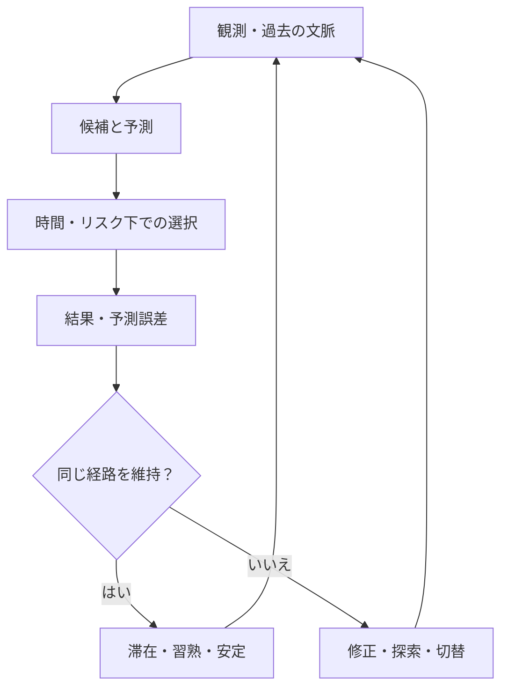

# 文献調査：選択経路はいかに選ばれ、維持・変更されるか

作成日：2026-10-21／対象：元メモ `261021(5).md` の49候補＋安部達雄・Seth Roberts の2件＝51候補。

## 要旨

本調査の研究質問は「複数の選択肢があるとき、時間・記憶・予測・フィードバックによって選ばれる経路とその安定性はどう変わるか」である。独自理論の名称・状態数・時間刻みを前提にしない。候補の多くは互いに研究対象が異なるため、単一の因果連鎖が実証済みであるとみなさない。

**最も重要な結論**：①情報が十分に確定する前に行動することがある、②選択可能な行動は並行して競合し得る、③過去の文脈と予測の誤差は次の状態に影響し得る、④経路の維持は報酬・損失・慣習・制約・状態依存など複数の原因で起こり、単一の「責任」に還元できない、⑤安定性には維持率・再訪率・摂動後回復・外乱に対する頑健性など別々の操作的定義が要る。

## 判定法

- **A**：出版元、著者、学会、機関リポジトリ、PubMedまたは原著arXivで同定。今回主に要旨・公開本文の可視部分を確認。
- **B**：近い正式タイトル候補を特定。ただし元メモの同一論文と断定できない。
- **C**：元メモの表記のままでは確定できず、結果の断定を保留。
- **R**：撤回済み。論拠として使用しない。

以下の「内容」は要旨中心の調査結果であり、全51本の本文を最初から最後まで精読したという意味ではない。仮説・モデル・シミュレーションを実験的証明と混同しない。リンクは一次資料優先。

## 全件調査台帳（元メモの順序を維持）

| No. | 文献（簡略名） | 判定 | 何を調べ、何が分かった／提案されたか | 研究質問との関係・留意点 |
|---:|---|:---:|---|---|
| 01 | [早押しクイズに見る不確実性下の判断](https://doi.org/10.11225/cs.2024.004)（白砂・小坂, 2024） | A | 大会記録から押下位置と確定ポイントを比較。89問のうち66問が正答一意確定前の押下で、その66問中42問は正答。誤答許容度に応じ方略が変化。 | **非常に近い**。確定前の行動、失敗コストと待機時間のトレードオフ。ただし事例研究。 |
| 02 | [Quantum-like cognition and decision-making in the light of quantum measurement theory](https://arxiv.org/abs/2503.05859) | A | 質問順効果と回答再現性を量子測定のinstrument/POVMで形式化し、射影測定だけの限界を論じる。 | 順序による判断の変化。脳が物理的に量子計算する証拠ではない。 |
| 03 | [Probing for intentions: The early readiness potential does not reflect awareness of motor preparation](https://doi.org/10.1162/imag_a_00465)（2025） | B | 運動準備電位と意図の自覚の時間関係を検討。メモの短縮名に対応する有力候補。 | 意図・準備・実行の時点は区別が必要。2019年の別著『Probing for Intentions: Why Clocks Do Not Provide the Only Measurement of Time』も存在。 |
| 04 | Veto Libet Task（2024） | C | 「Veto」「Libet task」はパラダイム／課題名としては理解できるが、記載そのままの著者・論文を一意同定できず。 | 意図した行動の停止・取消しを扱う候補として再検索。効果量の引用不可。 |
| 05 | [Decision-making components and times revealed by the single-trial electroencephalogram](https://elifesciences.org/articles/108049) | B | 単一試行EEGから決定過程に含まれる時間的イベントを推定。元メモの「lateralized readiness potential」とはタイトルが異なる。 | 証拠処理と運動準備の時点分離。元文献との完全一致は要再照合。 |
| 06 | Tracing the neural trajectories of evidence accumulation（2025–26） | C | 類似テーマの論文が複数あり、元表記だけでは確定できず。 | 証拠蓄積を神経状態の軌跡として測る関連領域。固有結果は引用しない。 |
| 07 | [Cortical mechanisms of action selection: The affordance competition hypothesis](https://pmc.ncbi.nlm.nih.gov/articles/PMC2440773/)（Cisek, 2007） | A | 利用可能な複数の行動候補が前頭・頭頂皮質などで並行して表現され、競合し得るという理論。 | **中核**。候補生成と選択を単純な逐次段階に固定しない。仮説的枠組み。 |
| 08 | A neural circuit mechanism for learning and decision-making | C | この表記だけでは一次論文を一意同定できず。学習則・価値選択の神経回路研究が候補。 | 神経回路の学習・選択をつなぐが、特定の結論は保留。 |
| 09 | [Biomimetic model of corticostriatal micro-assemblies discovers a neural code](https://www.nature.com/articles/s41467-025-67076-x) | A | 皮質―線条体の微小回路を生理学に沿ってシミュレーションし、誤行動を予測する特定の神経応答を報告。 | 予測・行動・強化信号の回路的連結。モデルと実測検証範囲を区別。 |
| 10 | [Investigation of the Sense of Agency in Social Cognition, Based on Frameworks of Predictive Coding and Active Inference](https://pmc.ncbi.nlm.nih.gov/articles/PMC7509423/)（Ohata & Tani, 2020） | A | 模倣相互作用を予測符号化・能動的推論のロボット／RNNモデルで分析。 | 予測可能性・自他の行動との関係。シミュレーション依存。 |
| 11 | [Characterizing the sense of agency in human–robot interaction based on the free energy principle](https://www.nature.com/articles/s44260-024-00026-8)（Ohataら, 2025） | B | 人とロボットの模倣相互作用をモデル化し主体感を検討。元メモより正式タイトルが長い。 | 行動主導権の遷移と予測。因果的寄与の尺度とは別概念。 |
| 12 | [Concepts and Measures of Agency](https://ora.ox.ac.uk/objects/uuid:cdecbaca-447c-43b7-8e3f-851517b5ff97)（Alkire, 2008） | A | agencyの複数の概念・測定法と、尺度が捉える部分／捉えない部分を論じる。 | 「自分で選ぶ力」は単一測度ではない。心理・開発研究寄り。 |
| 13 | Quantum Decision Making in Economics | C | 広い題目に該当する本・論文が複数あり特定不可。 | 意思決定の数学的形式化だが、個別成果の引用不可。 |
| 14 | [Quantum Decision Making with Small Sample for Network Monitoring and Control](https://www-mura.ist.osaka-u.ac.jp/achievements/annual_report/web2022/paper/t-otoshi21icqcdm-quantumCognition.pdf) | A | 少人数の判断をネットワーク監視・制御に応用する量子認知型モデル。 | 小標本条件と順序効果のモデル化。通常の確率モデルとの比較が必要。 |
| 15 | [A Distributed Representation of Temporal Context](https://memory.psych.upenn.edu/files/pubs/HowaKaha02.pdf)（Howard & Kahana, 2002） | A | 過去文脈を想起すると現在の時間文脈が変化するTCMモデル。 | **中核**。履歴が次の検索・状態に影響。記憶課題でのモデル。 |
| 16 | [Determining embedding dimension for phase-space reconstruction using a geometrical construction](https://doi.org/10.1103/PhysRevA.45.3403)（Kennelら, 1992） | A | 偽最近傍（FNN）で時系列の状態空間埋め込み次元を推定。ノイズの影響も検討。 | 見かけ上の状態近接と真の軌道構造を区別。有限状態数の根拠ではない。 |
| 17 | [Practical method for determining the minimum embedding dimension of a scalar time series](https://doi.org/10.1016/S0167-2789(97)00118-8)（Cao, 1997） | A | スカラー時系列の最小埋め込み次元推定法を提案。 | 時系列から状態の次元を検討する方法。 |
| 18 | [Structured spontaneous activity through delta oscillation-based discrete states in the medaka telencephalon](https://www.nature.com/articles/s41598-026-51830-2) | A | メダカ脳活動の離散状態をクラスタ化し、状態滞在と遷移の非一様性を分析。 | **近い**。状態滞在・同一状態への再遷移の観測例。クラスタ数は設計・データに依存。 |
| 19 | [Neuronal wiring diagram of an adult brain](https://www.nature.com/articles/s41586-024-07558-y)（Dorkenwaldら, 2024） | A | 成虫ショウジョウバエ脳の約139,255ニューロン・約5,000万シナプスを再構成。 | 結線の構造資料であり、時間的な選択経路を直接証明しない。 |
| 20 | [Quantification of Information Flow by Dual Reporter System and Its Application to Bacterial Chemotaxis](https://doi.org/10.1103/jrph-wj94) | A | 二つのレポーター信号を使って細菌走化性経路の情報流を定量化。 | 情報伝達の測定方法として重要。意識的判断との同一視不可。 |
| 21 | [Cybernetical Concepts for Cellular Automaton and Artificial Neural Network Modelling and Implementation](https://arxiv.org/abs/2001.02037) | A | Simondonのallagmatic思想から、複雑系を記述する汎用メタモデルのコード化を論じる。 | 構造と操作の分離という設計思想。実証的な一般法則ではない。 |
| 22 | [Provable self-organizing pattern formation by a swarm of robots with limited knowledge](https://doi.org/10.1007/s11721-019-00163-0)（Coppolaら, 2019） | A | 限られた局所情報のロボットが形成する集団パターンの設計と形式的検証。 | **中核**。局所規則・全体安定・保証条件。個人の認知過程とは対象が違う。 |
| 23 | [Pruning as a Game: Equilibrium-Driven Sparsification of Neural Networks](https://arxiv.org/abs/2512.22106) | A | ネットワーク疎化を参加変数とパラメータの均衡問題として定式化。 | 均衡・選択された構造の維持。人間の経路選択に直結はしない。 |
| 24 | [Dataset Distillation Efficiently Encodes Low-Dimensional Representations from Gradient-Based Learning of Non-Linear Tasks](https://proceedings.mlr.press/v306/kinoshita26a.html) | A | 非線形課題の学習から、蒸留データが低次元の課題情報を保持する仕組みを理論解析。 | 履歴の要約・保持に類比可能。ただし「経験の普遍的圧縮法」の証明ではない。 |
| 25 | [Influence-Guided Symbolic Regression: Scientific Discovery via LLM-Driven Equation Search with Granular Feedback](https://arxiv.org/abs/2605.29184) | A | 候補数式の探索に細粒度フィードバックを利用する方法。 | 評価信号が探索方向をどう変えるかを実装で見る候補。 |
| 26 | [ScientistTwo: Pioneering the Human Knowledge Frontier with Autonomous AI](https://arxiv.org/abs/2609.19644) | A | 人間が課題を与え、AIが研究ボトルネックを探索する自律研究システムを提案。 | 探索・評価・再試行のシステム例。主張・検証コード・第三者再現性は分ける。 |
| 27 | [Leveraging Peer, Self, and Teacher Assessments for Generative AI-Enhanced Feedback](https://arxiv.org/abs/2512.18306) | A | 工学系学生の口頭発表について教員・同輩・自己評価を組み合わせる支援。 | 複数の評価主体が改善に与える影響。因果比較の設計に注意。 |
| 28 | [Bridging Kolmogorov Complexity and Deep Learning: Asymptotically Optimal Description Length Objectives for Transformers](https://arxiv.org/abs/2509.22445) | A | 記述長の最適性をTransformerの目的関数と結びつける理論提案。 | 最短説明／圧縮という視点。直接の行動予測モデルではない。 |
| 29 | [A Definition of Good Explanations and the Challenges Explaining LLM Outputs](https://arxiv.org/abs/2606.14838) | A | 反実仮想と説明される側の信念を含む「良い説明」の定義を検討。 | 経路の説明は単なる事後物語でないことを要求。定義自体は提案。 |
| 30 | [Linguistic properties and model scale in brain encoding: from small to compressed language models](https://arxiv.org/abs/2602.07547) | A | 言語モデルの規模・圧縮と脳活動への対応、言語特性を比較。 | モデル内部表現の縮約に関係。行動選択への外挿は慎重に。 |
| 31 | Language Modeling by Language Models | C | 同名・類似名の候補があり、元表記だけでは著者と版を確定できず。 | 言語モデルで別モデルの表現を学ぶ研究領域。固有結果を保留。 |
| 32 | External commentary on Verbalizable Representations Form a Global Workspace in Language Models | B | 「External commentary」は論文タイトルでない。原研究は[Verbalizable Representations Form a Global Workspace in Language Models](https://arxiv.org/abs/2607.15495)。 | 中間層で言語化可能な表現の共有を報告。意識の実証と同一視不可。 |
| 33 | [Is One Layer Enough? Training a Single Transformer Layer Can Match Full-Parameter RL Training](https://arxiv.org/abs/2607.01232) | A | 特定条件の強化学習後学習で単一層の更新が全パラメータ更新に匹敵し得ることを報告。 | 更新の局在性。一般のAIが1層で足りるという主張ではない。 |
| 34 | [Hallucination as a Computational Boundary: A Hierarchy of Inevitability and the Oracle Escape](https://ojs.aaai.org/index.php/AAAI/article/view/40657) | A | 計算可能性の階層から生成AIの幻覚限界と検索・継続学習を議論。 | 説明や知識の限界条件。提示された理論上の「escape」を無条件保証と読まない。 |
| 35 | [Development of the Personal Responsibility Scale for adolescents](https://doi.org/10.1016/j.adolescence.2016.05.011)（Mergler & Shield, 2016） | B | オーストラリアの青少年を対象に個人的責任感の心理尺度を開発。元メモは尺度名。 | 主観的責任感と行動の因果寄与は別。 |
| 36 | [Measuring Personal and Social Responsibility: An Existential Positive Psychology Approach](https://www.journalofhappinessandhealth.com/index.php/johah/article/view/5)（Arslan, 2022） | B | 個人・社会的責任の心理的測定に関する候補。元メモのRQ/RSと同一尺度かは未確定。 | 対象と尺度項目の再照合が必要。 |
| 37 | [Development and validation of a personal responsibility scale for Chinese college students](https://www.frontiersin.org/journals/psychology/articles/10.3389/fpsyg.2023.1231462/full)（Ren, Wu & Qin, 2023） | B | 中国の大学生向け個人的責任尺度の信頼性・妥当性を評価。元メモのSelf-Responsibility Scaleと同一かは未確定。 | 主観尺度の測定法。国・文化の違いに注意。 |
| 38 | [The Responsibility Quantification (ResQu) Model of Human Interaction with Automation](https://arxiv.org/abs/1810.12644)（Douer & Meyer） | A | 情報理論で人間が自動化システムの結果に寄与する程度を定式化。 | **重要だが別問い**。寄与の大きさと、選択経路を保持した理由は同一ではない。初期モデルは時間的側面を捨象。 |
| 39 | [Theoretical, Measured, and Subjective Responsibility in Aided Decision Making](https://arxiv.org/abs/1904.13086) | A | モデル上の責任、実測の寄与、主観判断を比較。 | 客観的寄与と主観のずれを示す。選択経路の維持を責任だけで説明しない根拠。 |
| 40 | [A Logic-Based Analysis of Responsibility](https://arxiv.org/abs/2307.05070)（Ramírez Abarca, 2023） | A | 行為者の責任概念を論理体系で分析。 | 定義の明示が有用。因果測定の実験ではない。 |
| 41 | [Employee accountability: development of a multidimensional scale](https://doi.org/10.1080/10967494.2019.1690606) | A | 組織従業員のaccountabilityを多次元尺度として検討。 | 説明責任は自覚・他者評価の文脈を含む。行動の持続理由と異なる。 |
| 42 | [Applying Multidimensional Scaling for Responsibility Distribution Between Objects](https://www.jstage.jst.go.jp/article/ipsjjip/23/3/23_318/_article/-char/en)（Ida & Kaneda, 2015） | B | 概念的活動モデルから責務を抽出し、オブジェクトへ割り当てる設計手法。メモの2011年表記は出版年要訂正。 | ソフトウェア責務分担。心理的責任ではない。 |
| 43 | [Leveraging Large Language Models for Effective and Explainable Multi-Agent Credit Assignment](https://www.ifaamas.org/Proceedings/aamas2025/pdfs/p1501.pdf)（Nagpalら, AAMAS 2025） | A | 行動列の改善と寄与帰属をパターン認識課題として解くLLM-MCAを提案。 | 複数主体・複数行動への結果寄与の配分。 |
| 44 | [ブレイクダンスにおける即興的な対応方略とその要因](https://www.jcss.gr.jp/meetings/jcss2015/proceedings/keyword082.html)（清水・岡田, 2015） | A | 熟達ダンサーの長期フィールドワークで、基礎的パターンを作り状況に応じて複数レベルで改変することを報告。 | **非常に近い**。経路の再利用と状況依存の変更。ただし大会発表。 |
| 45 | [Fine-grained Human Motion Understanding with Language Models](https://arxiv.org/abs/2606.20888) | A | 時刻付き姿勢系列の詳細な動作変化を言語モデルで扱う研究。 | 動作の「何が・いつ変わったか」の表現。選択理由の因果推定とは別。 |
| 46 | [Text Dictates, Music Decorates: Energy-based Attention for Editable Dance Motion Generation](https://arxiv.org/abs/2606.22726) | A | 振付の意味構造（text）と時間リズム（music）を分けて条件付けする生成手法。 | 動作内容とタイミングの分解。生成研究であり技能評価ではない。 |
| 47 | [An Echo Chamber of One: Should AI Psychosis Be a Distinct Clinical Entity?](https://arxiv.org/abs/2608.23937) | A | 対話AIの継続利用と妄想性症状に関する概念整理。 | 強化される信念経路への警戒。臨床因果関係の証明ではない。 |
| 48 | [Characterizing the spiral: potential mechanisms in AI-associated delusions](https://www.nature.com/articles/s44277-026-00065-0) | A | 会話の相互適応から信念が増幅する「spiral」の仮説を提示。 | 望ましくないフィードバックによる持続。著者自身が機序を仮説と位置付ける。 |
| 49 | [Universal consciousness as foundational field: A theoretical bridge between quantum physics and non-dual philosophy](https://pubs.aip.org/aip/adv/article/15/11/115319/3372193/RETRACTED-Universal-consciousness-as-foundational) | **R** | 出版社が撤回を明記。正式な[撤回通知](https://pubs.aip.org/aip/adv/article/16/5/059902/3388991/Retraction-Universal-consciousness-as-foundational)あり。 | **理論の実証的根拠として使用しない**。 |
| 50 | [漫才における「フリ」「ボケ」「ツッコミ」のダイナミズム](https://waseda.repo.nii.ac.jp/record/1463/files/061.pdf)（安部達雄） | A | 表現者から理解者へ「おかしみ」が伝わり笑いになる過程を機能別・段階的に考察。 | 文脈形成・逸脱・再解釈の相互作用。時間のミリ秒機構は直接検証しない。 |
| 51 | [Self-experimentation as a source of new ideas: Ten examples about sleep, mood, health, and weight](https://pubmed.ncbi.nlm.nih.gov/15595236/)（Seth Roberts, 2004） | A | 12年の自己実験記録から新たな因果仮説の着想を検討。 | 長期反復から仮説を得る例。単一被験者の事後的発見を一般的因果法則としない。 |

## 比較のための概念整理

「選択」の実証には、最低でも候補集合、観測、選択行為、結果の4項目を定義する必要がある。さらに「維持」には次の別個の説明候補がある。

| 維持の候補原因 | 観測指標の例 | 対応する先行研究 |
|---|---|---|
| 期待報酬・損失コスト | 次の試行で同じ選択をする確率、反応時間 | 01, 07 |
| 学習済みパターン・習慣 | 過去の遷移への依存、反復による時間短縮 | 15, 44 |
| 予測との整合・誤差 | 予測誤差、予測の確信度、修正率 | 10, 11 |
| 環境制約と到達可能性 | 候補ごとの到達可能集合、局所ルール | 07, 22 |
| 状態依存・動力学的安定 | 滞在時間、再訪率、摂動後の回復 | 16–18, 22 |
| 対人的相互作用 | 応答遅延、発話順序、予想と逸脱 | 02, 50 |
| 規範・説明責任 | 他者への説明可能性、義務違反、主観尺度 | 35–43 |

**重要な区別**：「なぜその経路が選ばれたか（選択）」と「なぜ選ばれた経路が維持されたか（持続）」には別の因果要因があり得る。結果への責任は持続要因の一候補だが、同義ではない。

## 暫定的な研究枠組み（既存研究の合成仮説）

この図は論文同士を繋いだ**今後検証すべき仮説**であり、全過程を一研究が立証しているわけではない。

### 操作的な測定案

- 選択時間：候補が利用可能になった時点から行動開始までの時間（入力時点の定義が必要）。
- 不確実性：候補分布のエントロピー、確定可能時点、主観的確信度を分離。
- 維持：`P(a_t=a_{t-1})`、状態滞在時間、経路再使用率。
- 安定：環境摂動を加えた後の回復率・回復時間・状態分布の変動。単なる高頻度とアトラクタを同一視しない。
- フィードバック効果：フィードバックあり／なし（または即時／遅延）の比較により次試行の選択分布の差を測る。
- 個人差：同一課題・同一条件で個人ごとの分布差、学習速度差を比較。

### 実験への接続：ダンス

OptiTrackを基準測定とし、同一振付の熟達者・非熟達者、または同一人物の反復練習を比較する。YouTube動画の2D推定は別の観測系として誤差を見積もる。動作を30msで記録すること自体は分析上のサンプリング設計であり、30msが人間の普遍的な認知単位であるとは主張しない。離散状態の個数（4/8/16など）は先験的に固定するだけでなく、時系列の予測性能・再現性で比較する。強制的な周期遷移を与えた結果から、自発的な状態遷移を推定したと解釈しない。

## 推奨読解順（優先順位）

1. **判断の開始**：01 → 07 → 05 → 03（確定より前に何をしているか）。
2. **経路を残す／変える**：15 → 10 → 11 → 44（記憶・予測・熟練）。
3. **状態と安定性**：18 → 16 → 17 → 22（観測・埋め込み・形式的保証）。
4. **フィードバックと評価**：51 → 27 → 25 → 39（長期記録・相互評価・原因の区別）。
5. **説明の条件**：29 → 38 → 40 → 43（選択理由と責任帰属を混同しない）。
6. それ以外の文献は適用範囲と境界条件を補強するために用いる。

## 調査上の未解決項目

- No.04、06、08、13、31：書誌情報が不足しており、元メモの表記では**一意同定未了**。
- No.03、05、11、32、35、36、37、42：有力候補・正式タイトルを示したが、元メモとの同一性や年の照合が一部必要。
- No.49：撤回。先行研究の肯定的根拠から除外。
- 51候補の**横断的な初期調査は実施**。すべてを本文精読したという意味ではない。統計値・条件・図表の再抽出と独立追試は今後の別工程。

## 総括

既存研究が与える答えは、単純に「最善の経路が一つ選ばれ、その責任が保持する」という形ではない。情報が未確定でも選択が始まり、過去の文脈が次の候補を変え、損失・期待・学習・予測誤差・環境制約などが同じ経路の維持や切替を左右し得る。特に**「選択の生成」と「選択の維持」を別の従属変数にする**ことが研究設計上有望である。

最も直接的な基礎資料は01（リスクと判断時点）、07（行動候補の並行競合）、15（文脈記憶）、18（状態滞在と遷移）、22（局所規則と安定性）、44（熟達ダンサーのパターン変更）。これらの対象・時間スケール・保証範囲は異なるため、共通法則の成立は別途実験しなければならない。

---

## 追補（2026-10-21）：添付された2本のPDF本文の精読

この追補は上表No.50とNo.51に対応する。**新たな2件を加えて53件にしたわけではなく、既存の51候補中2件の検証を深めたもの**である。添付原文：`061(1).pdf`（11ページ）、`self-experimentation-as-a-source-of-new-ideas-ten-examples-about-sleep-mood-health-and-weight(3).pdf`（36ページ）。

### No.50 安部達雄『漫才における「フリ」「ボケ」「ツッコミ」のダイナミズム』

**研究の目的**：漫才において、発話のどこに「おかしみ」の対象が作られ、表現者から理解者へどう伝えられるかを、発話内容と文脈の操作から説明する。異なる二つの概念の対比が「異質」と認識されることを、おかしみが生まれ得る構造として扱う。ただし、その対比だけで必ず笑いが生まれるとはしていない。

**機能の定義**（PDFのpp.70–72）：

1. **フリ**：ボケに先行し、共通条件・予想される概念Aを設定／導出する。大きな話題枠組みを活性化する「スジフリ」と、後続の内容をより具体的に予測・制約させる「マエフリ」を区別。
2. **ボケ**：概念Bを提示し、対比の構造を完成させる。予測を利用する／しないという区別のほか、単独・列挙・連鎖・点在という現れ方を論じる。連鎖型では先行するボケ自体が次のマエフリとして機能する。
3. **ツッコミ**：成立した対比への注意を向けたり、新しい情報・解釈を追加したりする。注意喚起（否定・オウム返し・沈黙）と内容に踏み込むもの（訂正・意味指摘・比喩・否定的感想）の2種7類型。

**対象・方法**：市販の上演記録から漫才の台本を書き起こし、各発話に発話者と番号を付け、機能を分類。本文の主な事例はダウンタウン「誘拐」（3分57秒、94発話）。著者はまずボケを認定し、その後に前後のフリ・ツッコミを遡って認定したと注記している。この手続きは後知恵的な文脈同定になり得るため、リアルタイムの予測能力を測定したことにはならない。

**本文p.77にある集計**：

| 分類 | 件数 | 内訳 |
|---|---:|---|
| フリ | 19 | スジフリ8、マエフリ11 |
| ボケ | 16 | 単独12（予測はずし7、予測利用なし5）、連鎖3、点在1 |
| ツッコミ | 29 | 否定2、オウム返し1、沈黙2、訂正2、意味指摘5、比喩1、否定的感想16 |

注意：これらは**発話数ではなく機能の出現件数**である。同じ発話に複数機能があり得る。本文はすべてのボケで笑いが起こったと述べるが、比較実験や観客の反応時間・人数を使った一般的な因果推定ではない。

**今回の研究への含意**：

- 「先行する発話が後続の候補を絞る」ことを記述する具体的な分類体系がある。
- 一つの発話が「先の結果」であると同時に「次の条件」になる、連鎖型の分析がある。
- ツッコミは単なる否定でなく、気付きのマーカーにも意味の追加にもなる。結果に対する他者の反応をすべて「誤差フィードバック」と扱うのは粗すぎる。
- 次の実験では、解釈者が予想した次の発話の確率分布、予測からの逸脱量、ツッコミ後の解釈変化を、実時間の独立した参加者で測ると原研究のテキスト分析を拡張できる。

**限界**：一例への詳細な質的分析、機能認定の主観性、相手・聴衆の予測を直接測っていないこと、ミリ秒単位の時間機序を報告しないこと。

### No.51 Seth Roberts (2004) *Self-experimentation as a source of new ideas*

**研究の問い**：仮説の検証方法だけでなく、「検証する価値のある新しい仮説をどのように生成するか」。12年の自己観測・介入記録に基づき、長期自己実験が仮説生成の実践方法になり得ると論じた。掲載誌は *Behavioral and Brain Sciences* 27(2), 227–288。添付PDF36ページには原著部分のほか公開査読コメントも含まれる。

**例示された観測**：睡眠・気分・風邪症状・体重について、朝の顔映像視聴、立位時間、朝の照明、朝食、飲水、食事内容、無香料糖水などを変更したときの本人の反応を記録。著者は遅れて現れる気分変化、睡眠変化、体重変化などを報告し、「味とカロリーの連合が体脂肪のセットポイントに影響する」という仮説を提案する。

**方法の特徴**（原著pp.227–228、257–259）：

1. 日常の違和感・予想外の観測が新しい問いを生む。
2. 長期記録を時系列で可視化すると、当初の注目対象以外の変化や遅延効果に気付ける。
3. 短い介入・再介入で候補仮説を絞り、測定を追加して仮説を具体化する。
4. 仮説の**生成・試験・発展**を分けて考える。著者自身も最終的には通常の研究へ接続する流れを提案している。

**特に重要な反論**：添付PDFのOpen Peer Commentary冒頭（David A. Booth、p.263以降）では、①過去の自己観測を知っていることによる影響、②介入に混在する交絡、③「予想外だった」というだけでは証拠の強さにならない、④体重理論と既存研究との矛盾を指摘する。著者の自己実験は**仮説発見の事例**として有用だが、論文中の各健康効果を確立した医学的事実として引用してはならない。健康行動の推奨根拠にも用いない。

**今回の研究への含意**：

- 長年のダンスフィードバック記録を「結論の証拠」以前に、**候補仮説を発見するデータ**として位置付けられる。
- 予測していた変化だけでなく、予測外の変化を別系列として保存する意義がある。
- 記録から見つけたパターンの妥当性は、新しい人・新しい期間・独立した計測器・対照条件で検証する。
- 反復し続けたこと自体の価値と、特定の効果が本当に因果的かどうかは別の評価軸である。

**限界**：n=1、盲検困難、著者の期待・交絡・長期の環境変化、独立追試の不足。特に長期に観測するほど偶然の関連を多数見つけるため、探索で見つけた規則と確認的検証を厳密に分ける必要がある。

### この2本を一緒に読んで得られる研究上の問い

| 観点 | 安部の論文 | Robertsの論文 | 新しい検証案 |
|---|---|---|---|
| 過去の役割 | 先行発話が次の候補・期待を形成 | 過去の長期記録が次の仮説を形成 | 過去を参照したとき予測分布がどう変わるか |
| 予測外の事象 | ボケが期待を逸脱し得る | 予想外の観測が問いを生み得る | 逸脱後に探索・再試行が増えるか |
| 結果の扱い | ツッコミ等が意味や注意を変える | 結果を再観測・介入で検討する | フィードバックの種類で次の経路が変わるか |
| 限界 | 発話の事後的な質的分析 | 単一被験者の非盲検自己実験 | 実時間の独立計測と対照群を追加 |

結論として、この2本は「発話の前後」と「長期学習」という**異なる時間スケール**を示す。双方に「前の出来事が次の解釈・探索へ影響する」という接点はあるが、同一メカニズムを実証してはいない。
