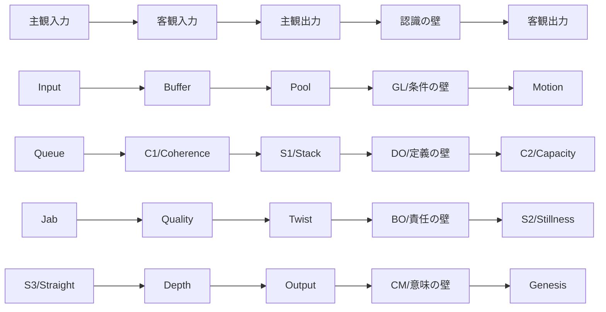
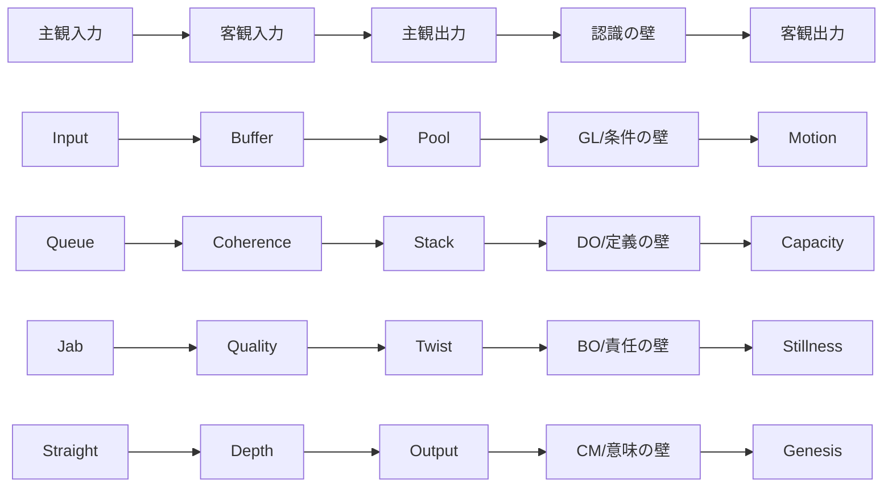
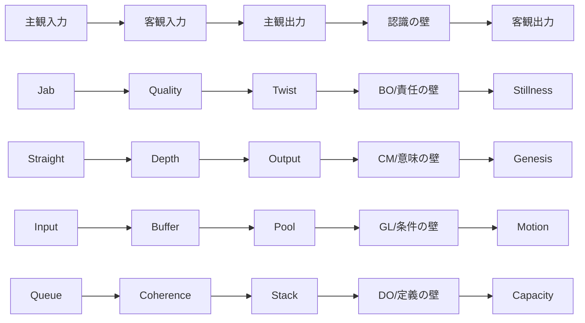

#Mine研究 
ちょいヴォイニッチ手稿見てみることにした。

仮説⬇️
0.03秒 👈意志を読む最小時間
0.5秒 👈行動が決定される最小時間
-> 0.03秒が読めない限り、0.5秒への準備はできないってことになる
この「0.03秒」を生み出すために、グロさが必須になるってことらしいのね。

このグロさは個別と集団とで全く異なる効果を生むとすら思っててw
集団の場合は「全体に合わせなければならん」という圧迫感から来るグロさ(昨日のスタジオの生々しい感じですわ)、個別の場合は「皆に見せられる精度にせなあかん」という緊張感から来るグロさ(俺の即興ダンスでの経験から持ってきてみました)なんだと思う。

男の子は個別の方、女の子は集団の方ってことになる気がするのねw
個別を味わうと「漢」に寄る、集団を味わうと「母」に寄るみたいなことになったりする？これなら凄く綺麗な気がしてきたww

グロさ = 微分可能範囲の拡大の変数(グロさの積分量がこれに該当するはずです)
0.03秒 = 微分可能範囲での実際の微分の最小単位
0.5秒 = 0.03秒で確保したメモリ分(微分した範囲だから、全体からすると凄く小さいことなんだけど、微分先を基準にすると大元の方が大きくなるので、結果として全体を最大化できるという仕組みになります)

グロは「何ができるか」を変え、エロは「今、何を使うか」を変える。
もっと言うとこれ「グロさは存在することと、気づかれることが別」

自分以外の存在によって、判断の更新を要求され続ける状態
グロさには、自分で引き受ける場合と、引き受けざるを得ない場合がある。

これ繋がってくるとかありそう👇
- **演劇：** あらかじめ決まった全体像に向けて、局所的な表現を調整する。
- **即興：** 局所的な表現を調整しながら、その場で全体像を成立させる。
-> 局所的には不自然でも、全体としては整合する

責任の壁到達 -> 局所的な不整合の検出 -> 全体的な基準の特定 -> 誇張の必要性を説明 -> 意味の壁到達
意味の壁到達 -> 題目発見 -> 条件の壁到達
条件の壁到達 -> 俯瞰 -> クラスタリング(教師なし学習) -> 定義の壁到達
定義の壁到達 -> 内部探索(論理的推論, 概算的推論...etc(👈ここが大抵地獄で、グロが溜まってくる箇所ですわ)) -> 責任の壁到達

男子は選べる、女子は選べない 👈これ、女子側が選べるようになったら(多分人工授精とかが可能になるみたいなことだと思うけどね)、逃げられなくなる = 自由度が限界突破するってのが言える気がするのねw

人間のグロさを理解する -> 責任の所在を把握する -> 意味の確定を急がなくなる

時間の中で意味が未確定のまま保持されている対象について、その内部を....
- グロさ：観測可能な範囲の本質の裏側を先読みできてしまうこと
- エロさ：観測可能な範囲の本質の裏側が滲み出ること

主観と客観は？ 👈これは構造だからどうということもできないのね。認める認めないってのが入るだけなんで。
基準固めの0.03秒、主観からの観測時間とグロ・エロ、認証自体のC$_1$とC$_2$、選択肢決定後の実行確定の0.5秒

こうしましょう：

⇧便～利w 

ちょい分かりやすい形にするわ：

エロが1111、グロが0000 👈表層に出てくるのが111の方。倍率ね。

一応こう定義しておきまして：
- **本質**：現在観測できる対象の特徴を成立させている構造
- **本質の裏側**：その構造が成立するまでの、直接観測できない条件・過程・履歴
グロさ＝観測情報から、未観測の成立過程を先読みすること
エロさ＝未観測の成立過程が、現在の観測情報に現れること

これが前提条件かも：時間の中で意味が未確定のまま保持されている対象について、その成立過程を読むことは許可されている
んで思ったこと：「エロ = Stillness目線でのBO / Stillness->BO」、「グロ = Genesis目線でのCM / Genesis->CM」 👈これならいける説ある？

Motion->GL 👈これが「ナンセンス」っていうのに該当する可能性あるっぽい

これなら正解とかあるかも？

エロ -> グロ -> ナンセンス 👈これが興味の順番とかだったりします？
とりあえず「イントロスペクション」というものにしておきますw 定義部分ねw

エロ -> グロ -> ナンセンス -> イントロスペクション 👈興味の順番 / 水の順路
イントロスペクション -> ナンセンス -> グロ -> エロ 👈表現の順番 / 水の逆路

基準・選択肢・更新規則....あと何？👇
1. **差がある**：現在の状態と、遷移先との間に圧力差が存在する。
2. **通れる**：その方向への遷移が許されている。
3. **動き出せる**：圧力差が抵抗を上回る。

圧力差($\Delta P$)・抵抗($R$)・基準($B$)・選択肢($A$)・更新規則($U$) 👈これだけあればいけるんちゃう？
$F(a,t)=\Delta P(a,t)-R(a,t)$

より重要なのだけ集めてみた：

ENRS：Enter・Neutral・Reverse・Stop

ダンス：
- (強制停止) - 置く / (111)-000 / (D)-G-(B)-GL
- 止める - 当てる / 001-010 / (B)-M-(C$_1$)-DO
- 乗る - 外す / 011-100 / (C$_1$)-C$_2$-(Q)-BO
- 打つ - 弾く - (強制停止) / 101-110-(111) / (Q)-S$_2$-(D)-CM

割とガチでなんすけどぉ....4つの壁・ENRS・ダンスの3つだけで全て表せるんじゃね？っていうのを思ってます今。なんか知らんけど凄い勘的な部分なんすけどね？w
何となくなんだけどめっちゃ思ってますww